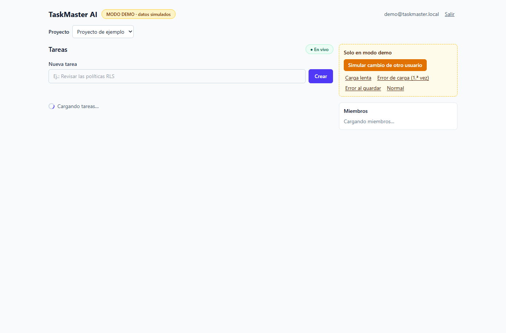
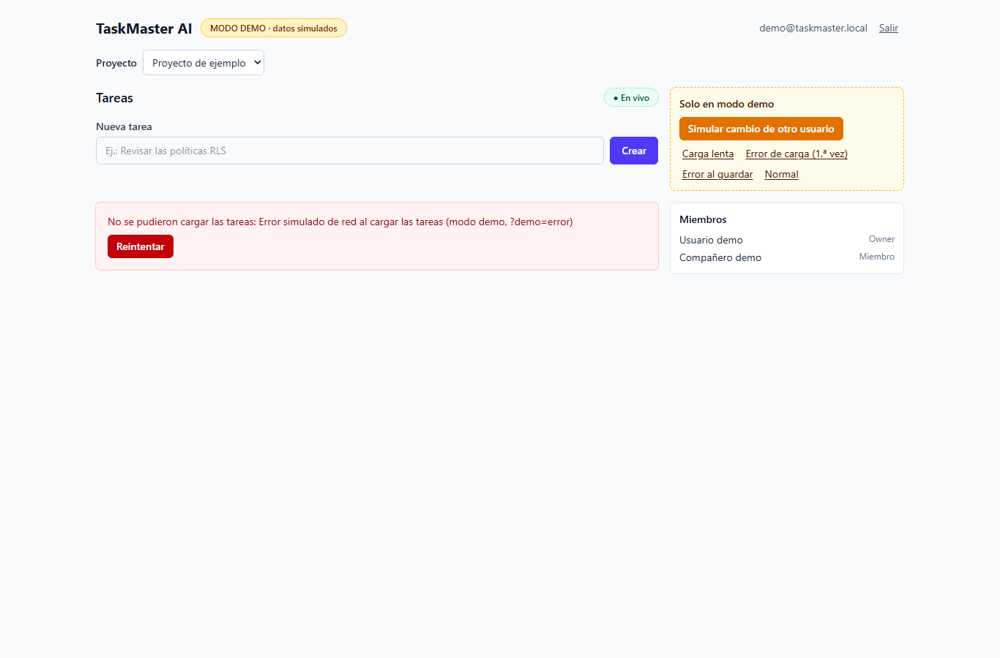
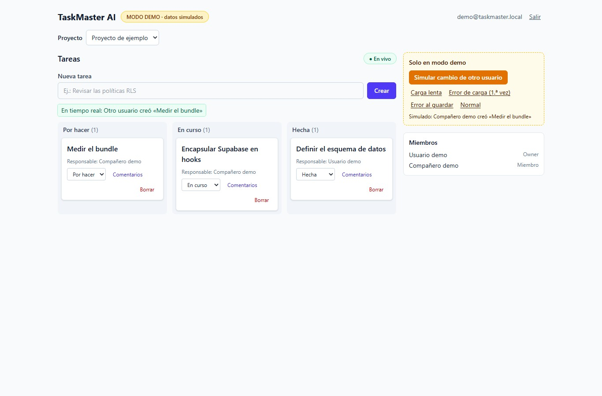
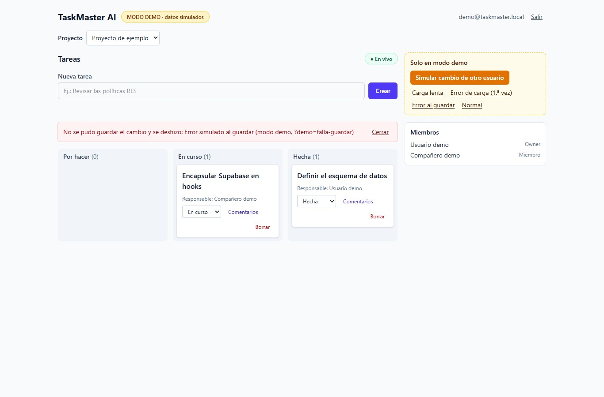
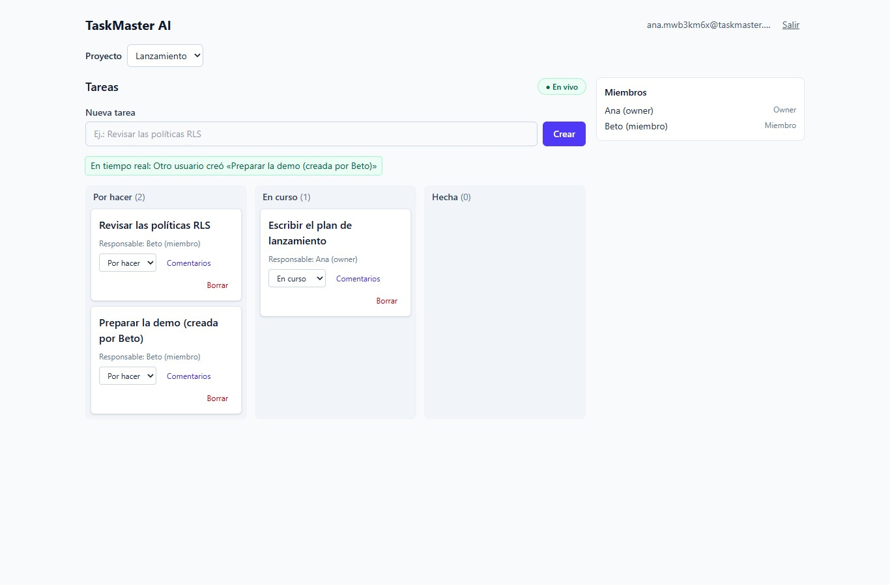
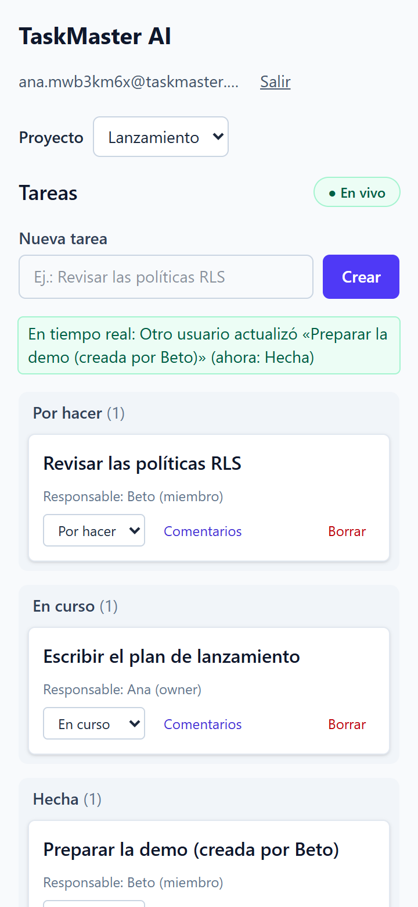
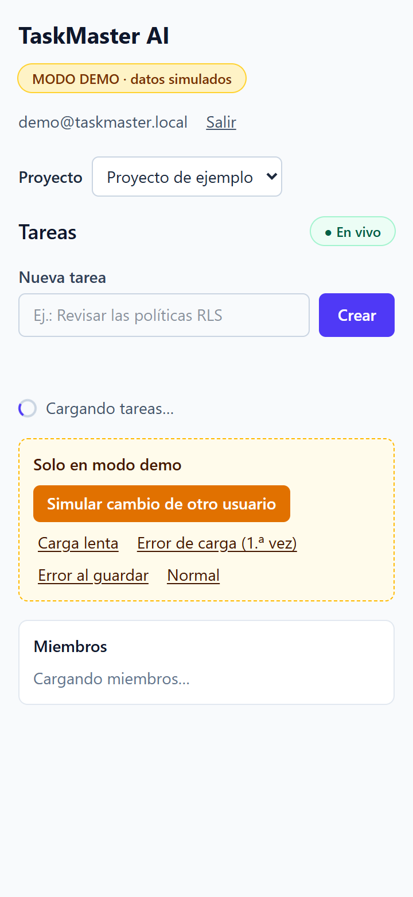
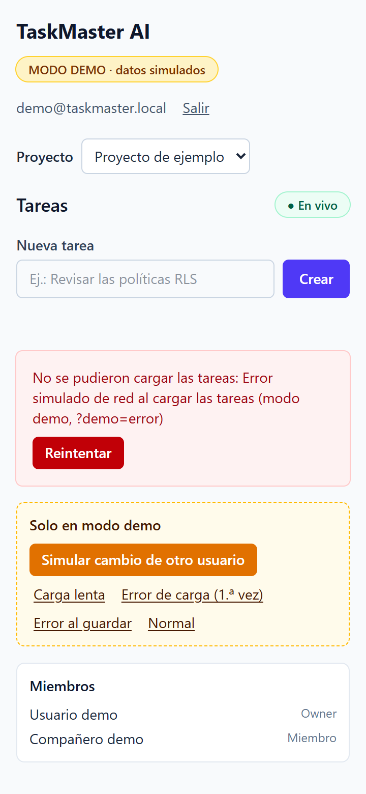

# TaskMaster AI · Arquitectura de persistencia con hooks personalizados

Proyecto Integrador, módulo 4 «Persistencia y Lógica». Documento técnico autocontenido: código completo del hook principal y del ejemplo de componente, memoria técnica, los cuatro ejes de la Auditoría IA, salida de la verificación y capturas. Generado por `herramientas/generar_documento.py` a partir de `docs/` y de `src/` (fuente única).

## 1. Qué se entrega y qué es real

| Entregable del enunciado | Sección |
|---|---|
| 1) Código del custom hook principal (`useTasks.ts`) con fetching, mutación y suscripción | 6.1 (y su núcleo en 6.2 a 6.4) |
| 2) Ejemplo de implementación en componente | 6.5 (`TaskBoard.tsx`) |
| 3) Memoria técnica de ~300 palabras (301, contadas con `herramientas/contar-palabras.py`) | 2 |
| Auditoría IA: análisis de código, prompts, bundle, RLS | 5 |

| Parte | Estado |
|---|---|
| Hooks, componentes, 38 pruebas, tsc, lint, build | Ejecutado en este equipo |
| Esquema SQL, RLS y Realtime | Ejecutado en Supabase **local** (CLI 2.122.0 + Docker) con tres usuarios reales: 32 de 32 |
| App contra Supabase | Ejecutado contra el Supabase **local** en el navegador (capturas 05 y 06) |
| Proyecto de Supabase en la nube | No ejecutado: no hay credenciales; `.env.example` sin valores |
| Modo demo | Datos simulados en memoria, rotulado «MODO DEMO · datos simulados» en pantalla |

## 2. Memoria técnica

**Por qué esta estructura.** La lógica de datos quedó en tres capas que solo dependen hacia abajo.
Los componentes llaman hooks (`useTasks`, `useComments`, `useProjectMembers`, `useProfiles`,
`useSession`). Los hooks hablan con repositorios, que son interfaces. Y solo los repositorios de
Supabase importan `supabase-js`. Una regla `no-restricted-imports` de oxlint hace fallar el lint si
un componente importa Supabase. La lógica difícil se escribió una sola vez en un núcleo,
`useRealtimeCollection`: carga, canal, reconciliación, optimismo y limpieza. Cada hook de entidad
solo declara su clave, su orden y sus mutaciones. Como el repositorio llega por contexto, el mismo
hook corre contra Supabase, contra un modo demo rotulado o contra un doble de prueba. Así se
probaron 38 casos sin red.

**Consistencia en tiempo real.** El canal `postgres_changes` filtra por `project_id=eq.<id>` y la
RLS decide qué eventos recibe cada usuario. Cinco decisiones sostienen la consistencia:

1. El id de una tarea nueva lo genera el cliente. La fila optimista ya tiene su clave real, así que
   el eco del INSERT y la respuesta HTTP caen sobre la misma fila, llegue primero cualquiera.
2. Mientras una mutación propia viaja, los eventos de esa fila se difieren. Al terminar se aplica
   el último con control de versión (`updated_at`): el eco no cambia nada y un cambio ajeno más
   nuevo gana. Si el servidor falla, se restaura la fila previa exacta.
3. Los DELETE se aplican como «quitar si está». Medido en Supabase local, llegan solo con el `id`
   y también a usuarios fuera del proyecto.
4. Cada `SUBSCRIBED`, al montar y en cada reconexión, recarga la lista. Realtime no reenvía lo
   perdido: tras reiniciar la base se perdió un INSERT.
5. Al cambiar de proyecto o desmontar se llama a `removeChannel`, se aborta la consulta y ninguna
   respuesta tardía toca el estado.

Límite conocido: entre dos ediciones simultáneas gana la última escritura.

## 3. Arquitectura y estructura de hooks

La interfaz no conoce a Supabase. Habla con hooks, los hooks hablan con interfaces de repositorio,
y solo `src/services/supabase/` importa `supabase-js`. Responde a la instrucción 1 del enunciado
(diseño de abstracción).

### 1.1 Entidades

| Entidad | Tabla | Hook | Repositorio (interfaz → implementaciones) | Tiempo real |
|---|---|---|---|---|
| Tareas | `tasks` | `useTasks(projectId)` | `TaskRepository` → Supabase, demo | Sí, filtro `project_id=eq.<id>` |
| Comentarios | `comments` | `useComments(taskId)` | `CommentRepository` → Supabase, demo | Sí, filtro `task_id=eq.<id>` |
| Usuarios (miembros) | `project_members` | `useProjectMembers(projectId)` | `ProjectMemberRepository` → Supabase, demo | Sí, filtro `project_id=eq.<id>` |
| Usuarios (perfiles) | `profiles` | `useProfiles(ids)` (caché por id) | `ProfileRepository` → Supabase, demo | No (casi no cambia) |
| Proyectos | `projects` | `useProjects()` | `ProjectRepository` → Supabase, demo | No (recarga) |
| Sesión | `auth.users` | `useSession()` | `AuthRepository` → Supabase Auth, demo | `onAuthStateChange` |

Los tipos están en `src/types/`. `CreateTaskInput` no deja fijar `created_by`, `created_at` ni
`updated_at`. El `id` sí puede ir, porque lo genera el hook (ver 1.4).

### 1.2 Capas

```
src/components/  TaskBoard, TaskForm, TaskItem, CommentsPanel, MembersList, Workspace, LoginScreen
      │  solo importan hooks y tipos  (oxlint: no-restricted-imports lo hace cumplir)
      ▼
src/hooks/       useTasks · useComments · useProjectMembers · useProfiles · useProjects · useSession
      │            └── todos componen useRealtimeCollection (núcleo) + reconcile.ts (funciones puras)
      │  dependen de las interfaces de src/services/types.ts, nunca de supabase-js
      ▼
src/services/    index.ts: createRepositories() con import() dinámico por modo
      ├── supabase/   repositorios reales + realtime.ts (canal y removeChannel)
      └── demo/       repositorios en memoria con la misma interfaz («modo demo» rotulado)
      ▼
src/lib/supabaseClient.ts   createClient(VITE_SUPABASE_URL, VITE_SUPABASE_ANON_KEY)
```

La regla de capas se probó en negativo: un componente que importa `@supabase/supabase-js`,
`../lib/supabaseClient` y `../services` hace fallar el lint con tres errores
([verificación final](docs/evidencia/verificacion-final.txt), sección «Regla de capas en negativo»).

### 1.3 El núcleo reutilizable

[`src/hooks/useRealtimeCollection.ts`](src/hooks/useRealtimeCollection.ts) implementa una sola vez
lo que comparten todas las entidades:

- Estado independiente `{ data, loading, error }`, más `mutationError`, `lastRemoteChange` y
  `realtime` (`off | connecting | live | offline`). Un fallo del canal no se presenta como error de
  carga.
- La suscripción Realtime se abre en un `useEffect`. La limpieza hace `removeChannel`, aborta la
  consulta en vuelo, quita los listeners de `visibilitychange` y `online`, y deja `scopeRef = null`.
- La reconciliación de INSERT, UPDATE y DELETE está en `reconcile.ts` (funciones puras, probadas aparte).
- `mutateUpsert` y `mutateRemove` aplican el cambio optimista y lo revierten si el servidor falla.

Cada hook de entidad solo aporta su clave (`keyOf`), su orden (`compare`), opcionalmente su versión
(`versionOf`) y sus mutaciones. `useTasks` tiene 136 líneas, de las que casi la mitad son
comentarios.

### 1.4 Decisiones

| Decisión | Por qué | Evidencia |
|---|---|---|
| El id de la tarea lo genera el cliente (`crypto.randomUUID()`) | El eco del INSERT y la respuesta HTTP caen en la misma fila sin importar cuál llega primero | prueba «no duplica el eco… aunque llegue ANTES»; Supabase local: «id repetido se rechaza» |
| Eventos diferidos mientras hay una mutación propia en vuelo | Evita que el eco pise lo optimista y que la reversión resucite una fila que otro usuario borró | prueba «un cambio ajeno… durante una edición propia fallida no se pierde» |
| DELETE = «quitar si está» | Medido: con RLS el DELETE trae solo `{ id }` y le llega a quien no es miembro | [supabase-local.txt](docs/evidencia/supabase-local.txt) pruebas 27 a 29 |
| Recarga en cada `SUBSCRIBED` | El canal solo escucha desde su `SUBSCRIBED`; lo que pasa antes, o durante una caída, no llega | pruebas de reconexión (v4) |
| Repositorios por contexto | Mismo hook en Supabase, en demo y en pruebas, sin mocks de módulos | 38 pruebas sin red |
| `import()` dinámico por modo | El modo demo no descarga supabase-js (210 kB) | [3.3](docs/03-auditoria-ia.md#33-tamaño-de-bundle) |

Fuentes: `src/hooks/`, `src/services/`, [bitácora de prompts](bitacora/README.md).

## 4. Esquema SQL, RLS y Realtime

Esquema en una sola migración:
[`supabase/migrations/20261110000000_esquema_taskmaster.sql`](supabase/migrations/20261110000000_esquema_taskmaster.sql).
La aplicó la CLI de Supabase **local** (2.122.0, Docker, con el servicio Realtime) y se probó con
tres usuarios reales de Auth: Ana (owner), Beto (miembro) y Carla (fuera del proyecto). No se usó
ningún proyecto en la nube.

### 2.1 Tablas

`profiles` (un trigger sobre `auth.users` la llena) · `projects` (un trigger mete al creador como
`owner` en `project_members`) · `project_members` (PK `project_id, user_id`) · `tasks` · `comments`.
Las claves foráneas usan `on delete cascade` donde corresponde, y hay índices por `project_id` y
`task_id`. `created_by` y `author_id` tienen `default auth.uid()`, y la política exige que coincidan.

### 2.2 RLS por pertenencia al proyecto

- Las cinco tablas tienen `enable row level security`. Las políticas usan funciones `security
  definer` con `search_path = ''` (`is_project_member`, `is_project_owner`, `can_access_task`,
  `shares_project_with`) para no caer en recursión sobre `project_members`.
- **Privilegios:** Supabase concede todo a `anon` y `authenticated` en cada tabla nueva, y las
  políticas no quitan esos privilegios. Por eso se revoca todo y se concede por columna. Leído de la
  base ([rls-politicas.txt](docs/evidencia/rls-politicas.txt)): `anon` tiene **0** privilegios en
  `public`, y `authenticated` solo puede insertar en `tasks (assignee_id, description, id,
  project_id, status, title)` y actualizar `tasks (assignee_id, description, status, title)`.
  `project_id` y `created_by` no se pueden actualizar.
- Un trigger impide que un proyecto se quede sin owner, salvo en un borrado en cascada.

### 2.3 Realtime

- `tasks`, `comments` y `project_members` están en la publicación `supabase_realtime`, con
  `replica identity full`.
- **Medido en local:** los INSERT y UPDATE solo le llegan a quien es miembro. Los **DELETE llegan
  con `old = { id }`** aunque la tabla tenga `replica identity full`, y le llegan también a Carla,
  incluso en su canal con filtro `project_id=eq.<id>`. No filtran datos, porque solo traen la clave,
  pero sí revelan que existió ese id. El cliente los trata como «quitar si está».

### 2.4 Resultado: 32 de 32

[`docs/evidencia/supabase-local.txt`](docs/evidencia/supabase-local.txt), generado con
`bash herramientas/probar-supabase-local.sh`:

| Bloque | Pruebas |
|---|---|
| Auth y triggers: perfil, owner automático, `created_by` puesto por la base | 1–5 |
| Carla no entra ni ve el proyecto (lista vacía, no error) | 6–7 |
| Suscripción con filtro; INSERT y UPDATE en tiempo real para Beto | 8–13 |
| `id` generado en el cliente: aceptado; repetido, rechazado; no le sirve a Carla | 14–16 |
| Carla no ve, no crea, no actualiza ni borra tareas | 17–20 |
| Privilegios por columna: `created_by` y `project_id` no se reescriben; `anon` no lee | 21–23 |
| Comentarios: `author_id` lo pone la base; Carla no los ve | 24–25 |
| DELETE en tiempo real (solo `id`), nada de INSERT ni UPDATE para Carla | 26–29 |
| Último owner, borrado en cascada, `removeChannel` deja el cliente sin canales | 30–32 |

Intentos guardados: con el esquema de v1, 29 de 29
([bitacora/v1/supabase-local.txt](bitacora/v1/supabase-local.txt)). Justo después de
`supabase db reset`, el primer intento dio `CHANNEL_ERROR` y el segundo perdió el primer INSERT
([intento 1](bitacora/v2/supabase-local-intento-1-realtime-reiniciando.txt),
[intento 2](bitacora/v2/supabase-local-intento-2-primer-evento-perdido.txt)). Ese segundo
intento motivó la recarga en cada `SUBSCRIBED`.

Log de la CLI, con las claves redactadas: [`docs/evidencia/cli/`](docs/evidencia/cli) (`--version`,
`init`, `start`, `status`, `migration list`, `db reset`, `stop`).

## 5. Auditoría IA

El diagrama «AUDITORÍA IA» del módulo 4 tiene cuatro ejes: Análisis de código, Optimización de
prompts, Tamaño de bundle y Verificación RLS. Cada uno tiene aquí su evidencia en un archivo de
texto del repositorio.

### 3.1 Análisis de código

| Herramienta | Resultado final | Archivo |
|---|---|---|
| `tsc -b --noEmit` (TS 7 estricto: `strict`, `noUncheckedIndexedAccess`, `exactOptionalPropertyTypes`, `erasableSyntaxOnly`) | 0 errores | [verificacion-final.txt](docs/evidencia/verificacion-final.txt) |
| `oxlint --deny-warnings` (plugins react, typescript, oxc, jsx-a11y; `react/exhaustive-deps: error`) | 0 errores, 0 avisos | ídem |
| Regla de capas `no-restricted-imports`, probada en negativo | 3 errores esperados en un componente que importa Supabase, lib y services | ídem, «Regla de capas en negativo» |
| Vitest 5 + Testing Library 16 | 38 de 38 | [pruebas-detalle.txt](docs/evidencia/pruebas-detalle.txt) |

Qué encontró el análisis en cada versión (fallos reales, no reconstruidos):

| Versión | tsc | lint | pruebas | Hallazgo que pasó al siguiente prompt |
|---|---|---|---|---|
| v1 | 0 | 2 avisos (código 1) | — | `set-state-in-effect` en el núcleo; `prefer-tag-over-role` |
| v2 | 0 | 1 error, 6 avisos | 26/29 | Una prueba de UI rompe la regla de capas; Testing Library no limpia el DOM; una prueba mal armada; el lint revisaba `bitacora/` (configuración anidada) |
| v3 | 0 | 0 | 34/35 | Una reconexión con una carga en vuelo pierde el cambio |
| v4 | 0 | 0 | 36/36 | (bundle: un solo chunk de 474 kB) |
| v5 | 0 | 0 | 37/37 | — |
| final | 0 | 0 | 38/38 | Ajuste tras las capturas: estados del modo demo, aviso en móvil, «Usuario» mientras carga |

### 3.2 Optimización de prompts

Cinco prompts. Cada uno cita la salida **real** de la verificación anterior (errores literales de
tsc, oxlint, Vitest y Supabase local), no lo que la versión anterior decía de sí misma. Detalle y
diffs en la [bitácora](bitacora/README.md).

| Prompt | Qué se optimizó respecto del anterior |
|---|---|
| 1 · diseño | Stack con versiones exactas y reglas de TS estricto. Restricciones que en labs anteriores se olvidaron: revocar privilegios, `created_by` puesto por la base, `replica identity full`. Separa diseño de lógica. |
| 2 · lógica | Pega los avisos de lint de v1 y el resultado de Supabase local (29/29 y el hallazgo de los DELETE). Exige decidir entre dos soluciones al eco y justificar. Pide las pruebas caso por caso. |
| 3 · auditoría | Pega los 3 fallos de Vitest y el error de lint con su ruta. Agrega dos hallazgos que ninguna herramienta vio: `CHANNEL_ERROR` mostrado como error de carga y proyectos sin recargar tras el login. Pide la tabla hallazgo → cambio → prueba. |
| 4 · reconexión | Un solo fallo. Pide explicar la causa antes de corregir y extender el caso al primer montaje. |
| 5 · bundle | Da la composición medida y advierte que la trampa conocida (medir sin variables) aquí no aplica. Pide decir también qué no se gana. |

Lo que no funcionó, también registrado: la primera respuesta al prompt 1 quedó cortada porque otra
sesión escribió en la misma carpeta. Desde el prompt 2 las respuestas se escribieron en la sesión
principal, porque se agotó el límite de subagentes, y se guardaron siempre **antes** de verificar.

### 3.3 Tamaño de bundle

Medido con `vite build` (Rolldown) y con `herramientas/medir-bundle.sh` (un chunk por paquete, solo
para medir). Archivos: [bundle.txt](docs/evidencia/bundle.txt), [v4/bundle.txt](bitacora/v4/bundle.txt).

| | Antes (v4) | Después (v5 y final) |
|---|---|---|
| Chunk inicial | 474,73 kB (134,36 kB gzip), un solo archivo | `index` 247,41 kB (76,42 kB gzip) |
| Lo que descarga el **modo demo** | 474,73 kB | ≈ 256 kB: `index` + `demo` 7,25 + `validation` 1,34. **supabase-js no se descarga** (comprobado en el navegador) |
| Lo que descarga el **modo Supabase** | 474,73 kB | ≈ 470 kB: `index` + `supabaseClient` 216,16 + `supabase` 4,91 + `validation` 1,34. El demo no se descarga |
| Composición (por paquete) | react 218,77 · supabase-js 210,07 · app 31,26 · demo 8,49 | igual, repartido en chunks |

Qué **no** se ganó: en modo Supabase el total casi no cambia y se agrega una petición encadenada.
El piso es React, con ≈ 219 kB. La trampa de labs anteriores, que el build sin variables saliera
más chico porque el minificador quitaba `createClient`, aquí no aparece: los dos builds pesan lo
mismo. Hallazgo de la herramienta: un `.env.local` olvidado contaminaba el build «sin variables» y
las pruebas. Desde entonces los scripts vacían `VITE_SUPABASE_*` a propósito.

### 3.4 Verificación RLS

- **Ejecutado, no supuesto:** la migración la aplicó la CLI de Supabase local y la probaron tres
  usuarios reales. Resultado: **32 de 32** ([supabase-local.txt](docs/evidencia/supabase-local.txt),
  detalle en [2.4](docs/02-esquema-y-rls.md#24-resultado-32-de-32)).
- **Leído de la base:** políticas, RLS activa, privilegios por columna, publicación Realtime y
  `replica identity` ([rls-politicas.txt](docs/evidencia/rls-politicas.txt)). `anon` tiene 0 privilegios.
- **Desde la app:** en el navegador, con el build de producción contra el Supabase local, la sesión
  de Ana recibió en tiempo real el INSERT, el UPDATE y el DELETE de Beto sin recargar
  ([navegador.txt](docs/evidencia/navegador.txt), capturas 05 y 06).
- **Lo que la RLS no cubre y el código asume:** los DELETE no pasan por RLS. Llegan con solo el
  `id` a cualquier suscriptor de la tabla, así que el hook nunca confía en su contenido.

## 6. Código

### 6.1 Hook principal: useTasks.ts

Archivo: `src/hooks/useTasks.ts`

```ts
// useTasks(projectId): tareas de un proyecto, en tiempo real. Hook principal del entregable.
//
// Compone el núcleo useRealtimeCollection (carga, canal Realtime, reconciliación, optimismo con
// reversión y descarte de respuestas tardías) y le agrega las mutaciones de la entidad. No importa
// supabase ni src/lib: recibe el TaskRepository por contexto, así funciona igual en modo
// Supabase y en modo demo, y se prueba con un repositorio falso.
//
// ─── Actualización optimista con reversión ─────────────────────────────────────────────────
//   createTask: el id se genera aquí con crypto.randomUUID(). La fila optimista ya tiene su clave
//     definitiva, así que la respuesta HTTP y el eco Realtime del INSERT caen sobre la misma fila
//     (llegue primero el que llegue). Si el servidor falla, la fila se quita.
//   updateTask: pinta { ...previa, ...cambios } al instante; si falla, vuelve EXACTAMENTE a la
//     fila previa (la guarda el núcleo dentro del mismo updater).
//   deleteTask: la quita al instante; si falla, vuelve a su posición (la da `compare`).
//   En los tres casos el error queda en `mutationError` y la promesa se rechaza.
//
// ─── Eco Realtime de las mutaciones propias ────────────────────────────────────────────────
//   Mientras la clave tiene una mutación en vuelo, el núcleo difiere sus eventos. Al terminar
//   aplica el último con control de versión (updated_at): el eco es igual a la respuesta y no
//   cambia nada (ni se anuncia como cambio remoto); un cambio ajeno más nuevo sí gana.
//
// ─── Limpieza y respuestas tardías ─────────────────────────────────────────────────────────
//   Al cambiar de projectId o desmontar: removeChannel del canal del proyecto anterior, abort de
//   la carga en vuelo, y ninguna respuesta (de carga o de mutación) toca el estado después.
//
// ─── Seguridad ─────────────────────────────────────────────────────────────────────────────
//   El hook no filtra por usuario: lo hace la RLS en la base. La consulta y el canal llevan el JWT
//   de la sesión, así que un usuario fuera del proyecto recibe una lista vacía y ningún
//   INSERT/UPDATE (medido con tres usuarios en Supabase local).
import { useCallback } from 'react'
import type { NewTaskFields, Task, UpdateTaskInput } from '../types'
import { useRepositories } from './RepositoriesContext'
import {
  useRealtimeCollection,
  type Compare,
  type KeyOf,
  type RealtimeStatus,
  type RemoteChange,
  type VersionOf,
} from './useRealtimeCollection'

export type UseTasksResult = {
  readonly tasks: readonly Task[]
  readonly loading: boolean
  /** Error de la carga. Un problema del canal no va aquí: va en `realtime`. */
  readonly error: Error | null
  /** Estado del canal Realtime: 'connecting' | 'live' | 'offline' ('off' sin proyecto). */
  readonly realtime: RealtimeStatus
  /** Error de la última mutación (el cambio optimista ya se revirtió). */
  readonly mutationError: Error | null
  /** Último cambio de OTRO usuario que llegó por tiempo real (los ecos propios no cuentan). */
  readonly lastRemoteChange: RemoteChange<Task> | null
  readonly createTask: (fields: NewTaskFields) => Promise<Task>
  /** Cambia solo los campos presentes (undefined = no tocar). Devuelve la fila del servidor. */
  readonly updateTask: (id: string, patch: UpdateTaskInput) => Promise<Task>
  readonly deleteTask: (id: string) => Promise<void>
  readonly refetch: () => Promise<void>
  readonly clearMutationError: () => void
}

// Definidos a nivel de módulo: el núcleo los usa como dependencias de sus efectos.
const taskKey: KeyOf<Task> = (row) => row.id ?? null
const oldestFirst: Compare<Task> = (a, b) =>
  a.created_at.localeCompare(b.created_at) || a.id.localeCompare(b.id)
const taskVersion: VersionOf<Task> = (row) => Date.parse(row.updated_at)

/** @param projectId proyecto seleccionado; null = sin proyecto (lista vacía, sin canal). */
export function useTasks(projectId: string | null): UseTasksResult {
  const { tasks: repository } = useRepositories()
  const { data, loading, error, realtime, mutationError, lastRemoteChange, refetch, controls } =
    useRealtimeCollection({
      scopeId: projectId,
      source: repository,
      keyOf: taskKey,
      compare: oldestFirst,
      versionOf: taskVersion,
    })

  const createTask = useCallback(
    async (fields: NewTaskFields): Promise<Task> => {
      if (projectId === null) throw new Error('No hay un proyecto seleccionado')
      const id = crypto.randomUUID()
      const now = new Date().toISOString()
      const optimistic: Task = {
        id,
        project_id: projectId,
        title: fields.title.trim(),
        description: fields.description ?? null,
        status: fields.status ?? 'todo',
        assignee_id: fields.assignee_id ?? null,
        created_by: null, // lo pone la base con auth.uid(); llega en la respuesta
        created_at: now,
        updated_at: now,
      }
      return controls.mutateUpsert(optimistic, () =>
        repository.create({ ...fields, id, project_id: projectId }),
      )
    },
    [projectId, repository, controls],
  )

  const updateTask = useCallback(
    async (id: string, patch: UpdateTaskInput): Promise<Task> => {
      const current = data.find((task) => task.id === id)
      if (current === undefined) throw new Error('La tarea no está en la lista')
      const optimistic: Task = {
        ...current,
        ...(patch.title === undefined ? {} : { title: patch.title.trim() }),
        ...(patch.description === undefined ? {} : { description: patch.description }),
        ...(patch.status === undefined ? {} : { status: patch.status }),
        ...(patch.assignee_id === undefined ? {} : { assignee_id: patch.assignee_id }),
      }
      return controls.mutateUpsert(optimistic, () => repository.update(id, patch))
    },
    [data, repository, controls],
  )

  const deleteTask = useCallback(
    (id: string): Promise<void> => controls.mutateRemove(id, () => repository.remove(id)),
    [repository, controls],
  )

  return {
    tasks: data,
    loading,
    error,
    realtime,
    mutationError,
    lastRemoteChange,
    createTask,
    updateTask,
    deleteTask,
    refetch,
    clearMutationError: controls.clearMutationError,
  }
}
```

### 6.2 Núcleo que compone useTasks: useRealtimeCollection.ts

Archivo: `src/hooks/useRealtimeCollection.ts`

```ts
// Núcleo reutilizable: estado { data, loading, error } + canal Realtime + reconciliación +
// mutaciones optimistas con reversión. useTasks, useComments, useProjectMembers, useProjects y
// useProfiles lo componen; ninguno repite esta lógica.
//
// QUÉ GARANTIZA
//   - Aislamiento por scope (projectId, taskId…): el estado recuerda a qué scope pertenece y el
//     render nunca muestra filas de otro scope. Al cambiar de scope o desmontar se cierra el canal
//     (el repositorio llama a client.removeChannel), se aborta la carga en vuelo y scopeRef pasa a
//     null: ninguna respuesta tardía, de carga o de mutación, vuelve a tocar el estado.
//   - Sin huecos entre carga y canal: el canal se pide ANTES de la carga y los eventos que llegan
//     con la carga en vuelo se reaplican sobre la respuesta (upsert idempotente por clave). Pero
//     el canal solo escucha desde su SUBSCRIBED, que con Supabase suele llegar DESPUÉS de que la
//     consulta salió: un cambio en ese intervalo no está en la respuesta ni llega como evento.
//     Por eso CADA SUBSCRIBED (el primero y los de cada reconexión) lanza una carga nueva que
//     aborta la que estuviera en vuelo: la lista final siempre sale de una consulta hecha con el
//     canal ya escuchando.
//   - Recuperación como red de seguridad: también se recarga cuando la pestaña vuelve a estar
//     visible o el navegador vuelve a estar en línea.
//   - Mutaciones propias: se pintan al instante; si el servidor falla se restaura la fila previa
//     exacta (o se quita la nueva), el error queda en `mutationError` y la promesa se rechaza.
//   - Ecos: mientras una clave tiene una mutación propia en vuelo sus eventos se difieren; al
//     terminar se aplica el último con control de versión. El eco es igual a la respuesta y no
//     cambia nada (ni se anuncia); un cambio ajeno más nuevo gana.
//
// QUÉ NO GARANTIZA
//   - Orden total entre usuarios: si dos personas editan la misma tarea a la vez, gana la última
//     escritura que acepta la base (last-writer-wins por updated_at). No hay fusión de campos.
//   - Que lleguen todos los eventos: Realtime no reenvía lo que se perdió (medido en Supabase local
//     tras reiniciar la base: el primer INSERT no llegó). Por eso las recargas de arriba; mientras
//     tanto la lista puede estar desactualizada, nunca mezclada con otro scope.
//   - Los DELETE no traen más que la clave primaria y le llegan también a quien no es miembro
//     (medido): solo sirven para quitar una fila que ya está en la lista.
import { useCallback, useEffect, useMemo, useRef, useState } from 'react'
import type { ChangeEvent, ScopedCollectionSource } from '../services/types'
import {
  applyChange,
  removeRow,
  upsertRow,
  type Compare,
  type KeyOf,
  type VersionOf,
} from './reconcile'

export type { Compare, KeyOf, VersionOf } from './reconcile'

/** Último cambio que llegó por tiempo real y modificó la lista (para avisar en la UI). */
export type RemoteChange<T> = {
  readonly type: 'INSERT' | 'UPDATE' | 'DELETE'
  readonly row: T
  readonly at: number
}

/**
 * Estado del canal, separado del error de carga:
 * 'off' = la fuente no tiene tiempo real · 'connecting' · 'live' · 'offline' (supabase-js reintenta).
 */
export type RealtimeStatus = 'off' | 'connecting' | 'live' | 'offline'

export type CollectionState<T> = {
  readonly data: readonly T[]
  readonly loading: boolean
  /** Error de la carga (consulta). Un problema del canal NO va aquí: va en `realtime`. */
  readonly error: Error | null
  /** Error de la última mutación que falló (el cambio optimista ya se revirtió). */
  readonly mutationError: Error | null
  readonly lastRemoteChange: RemoteChange<T> | null
  readonly realtime: RealtimeStatus
}

type InternalState<T> = CollectionState<T> & { readonly scope: string | null }

export type UseRealtimeCollectionOptions<T> = {
  /** null = no hay nada que cargar (p. ej. ningún proyecto seleccionado). */
  readonly scopeId: string | null
  /** Debe ser estable entre renders (viene del contexto de repositorios). */
  readonly source: ScopedCollectionSource<T>
  /** Debe ser estable: definir a nivel de módulo, no en línea. */
  readonly keyOf: KeyOf<T>
  /** Debe ser estable: definir a nivel de módulo, no en línea. */
  readonly compare: Compare<T>
  /** Opcional y estable: descarta eventos más viejos que la fila actual. */
  readonly versionOf?: VersionOf<T>
}

export type CollectionControls<T> = {
  /** Upsert optimista de `row`; `request` confirma con el servidor (su fila reemplaza a la optimista). */
  mutateUpsert: (row: T, request: () => Promise<T>) => Promise<T>
  /** Borrado optimista por clave; si `request` falla, la fila vuelve a su lugar. */
  mutateRemove: (key: string, request: () => Promise<void>) => Promise<void>
  /** Inserción sin optimismo (cuando no vale la pena pintar algo que se puede revertir). */
  upsertConfirmed: (row: T) => void
  clearMutationError: () => void
}

export type UseRealtimeCollectionResult<T> = CollectionState<T> & {
  readonly refetch: () => Promise<void>
  readonly controls: CollectionControls<T>
}

type PendingEntry<T> = { count: number; deferred: ChangeEvent<T> | null }

const NO_ROWS: readonly never[] = []

function emptyState<T>(scope: string | null, hasRealtime: boolean): InternalState<T> {
  return {
    scope,
    data: NO_ROWS,
    loading: scope !== null,
    error: null,
    mutationError: null,
    lastRemoteChange: null,
    realtime: scope !== null && hasRealtime ? 'connecting' : 'off',
  }
}

function toError(error: unknown): Error {
  return error instanceof Error ? error : new Error(String(error))
}

export function useRealtimeCollection<T extends object>(
  options: UseRealtimeCollectionOptions<T>,
): UseRealtimeCollectionResult<T> {
  const { scopeId, source, keyOf, compare, versionOf } = options
  const hasRealtime = source.subscribe !== undefined

  const [state, setState] = useState<InternalState<T>>(() => emptyState(scopeId, hasRealtime))
  // Derivado en el render: al cambiar de scope no se ve ni un frame de datos del scope anterior.
  const view: InternalState<T> = state.scope === scopeId ? state : emptyState(scopeId, hasRealtime)

  /** Scope montado. null tras la limpieza: las respuestas tardías ya no tocan el estado. */
  const scopeRef = useRef<string | null>(null)
  const pendingRef = useRef(new Map<string, PendingEntry<T>>())
  /** null = no hay carga en vuelo; arreglo = eventos recibidos durante la carga. */
  const bufferRef = useRef<ChangeEvent<T>[] | null>(null)
  const loadControllerRef = useRef<AbortController | null>(null)

  const keyOfEvent = useCallback(
    (event: ChangeEvent<T>) => (event.type === 'DELETE' ? keyOf(event.old) : keyOf(event.row)),
    [keyOf],
  )

  /** Cambia el estado del scope `scope`; si el estado aún es de otro scope, parte de uno vacío. */
  const patchScope = useCallback(
    (scope: string, change: (base: InternalState<T>) => InternalState<T>) => {
      if (scopeRef.current !== scope) return
      setState((prev) => change(prev.scope === scope ? prev : emptyState<T>(scope, hasRealtime)))
    },
    [hasRealtime],
  )

  /** Aplica un evento remoto (si cambia algo, queda como último cambio remoto). */
  const applyRemote = useCallback(
    (scope: string, event: ChangeEvent<T>) => {
      setState((prev) => {
        if (prev.scope !== scope) return prev
        const { data, row } = applyChange(prev.data, event, keyOf, compare, versionOf)
        if (row === null) return prev
        return { ...prev, data, lastRemoteChange: { type: event.type, row, at: Date.now() } }
      })
    },
    [keyOf, compare, versionOf],
  )

  const load = useCallback(
    async (scope: string): Promise<void> => {
      loadControllerRef.current?.abort()
      const controller = new AbortController()
      loadControllerRef.current = controller
      bufferRef.current = []
      const isStale = () => controller.signal.aborted || scopeRef.current !== scope

      try {
        const rows = await source.list(scope, controller.signal)
        if (isStale()) return
        const buffered = bufferRef.current ?? []
        bufferRef.current = null
        const pendingKeys = [...pendingRef.current.keys()]
        patchScope(scope, (base) => {
          let data = buffered.reduce<readonly T[]>(
            (acc, event) => applyChange(acc, event, keyOf, compare, versionOf).data,
            rows.toSorted(compare),
          )
          // Las claves con una mutación propia en vuelo conservan su versión local (optimista):
          // una recarga no debe borrar ni deshacer lo que el usuario acaba de hacer.
          for (const key of pendingKeys) {
            const mine = base.data.find((row) => keyOf(row) === key)
            data = removeRow(data, key, keyOf)
            if (mine !== undefined) data = upsertRow(data, mine, keyOf, compare)
          }
          return { ...base, data, loading: false, error: null }
        })
      } catch (error) {
        if (isStale()) return
        bufferRef.current = null
        patchScope(scope, (base) => ({ ...base, loading: false, error: toError(error) }))
      } finally {
        if (loadControllerRef.current === controller) loadControllerRef.current = null
      }
    },
    [source, keyOf, compare, versionOf, patchScope],
  )

  useEffect(() => {
    if (scopeId === null) return
    scopeRef.current = scopeId
    pendingRef.current = new Map()
    bufferRef.current = null
    let active = true
    let loadedOnce = false

    const unsubscribe = source.subscribe?.(
      scopeId,
      (event) => {
        if (!active) return
        const key = keyOfEvent(event)
        const pending = key === null ? undefined : pendingRef.current.get(key)
        if (pending !== undefined) {
          pending.deferred = event // se aplica cuando termine la mutación propia
          return
        }
        const buffer = bufferRef.current
        if (buffer !== null) {
          buffer.push(event)
          return
        }
        applyRemote(scopeId, event)
      },
      (status) => {
        if (!active) return
        if (status === 'SUBSCRIBED') {
          patchScope(scopeId, (base) => ({ ...base, realtime: 'live' }))
          // Siempre se recarga, aunque haya una carga en vuelo (v3 la dejaba seguir y fallaba): esa
          // carga pudo salir antes de que el canal escuchara, o antes de la caída, y no trae lo que
          // pasó entretanto. load() aborta la anterior; su respuesta tardía se descarta.
          void load(scopeId)
          return
        }
        // CHANNEL_ERROR, TIMED_OUT o CLOSED: los datos siguen siendo válidos; solo se marca el canal.
        patchScope(scopeId, (base) => ({ ...base, realtime: 'offline' }))
      },
    )

    void load(scopeId).then(() => {
      loadedOnce = true
    })

    // Red de seguridad para eventos perdidos: recargar al volver a la pestaña o a la red.
    const reloadIfVisible = () => {
      if (active && loadedOnce && document.visibilityState === 'visible') void load(scopeId)
    }
    document.addEventListener('visibilitychange', reloadIfVisible)
    window.addEventListener('online', reloadIfVisible)

    return () => {
      active = false
      scopeRef.current = null
      bufferRef.current = null
      loadControllerRef.current?.abort()
      document.removeEventListener('visibilitychange', reloadIfVisible)
      window.removeEventListener('online', reloadIfVisible)
      unsubscribe?.()
    }
  }, [scopeId, source, load, keyOfEvent, applyRemote, patchScope])

  const refetch = useCallback(async () => {
    const scope = scopeRef.current
    if (scope === null) return
    patchScope(scope, (base) => ({ ...base, loading: true, error: null }))
    await load(scope)
  }, [load, patchScope])

  const beginPending = useCallback((key: string) => {
    const pending = pendingRef.current
    const entry = pending.get(key) ?? { count: 0, deferred: null }
    entry.count += 1
    pending.set(key, entry)
    return entry
  }, [])

  const endPending = useCallback(
    (scope: string, key: string, entry: PendingEntry<T>) => {
      entry.count -= 1
      if (entry.count > 0) return
      if (pendingRef.current.get(key) === entry) pendingRef.current.delete(key)
      const deferred = entry.deferred
      if (deferred !== null && scopeRef.current === scope) applyRemote(scope, deferred)
    },
    [applyRemote],
  )

  const controls = useMemo<CollectionControls<T>>(() => {
    const requireScope = (): string => {
      const scope = scopeRef.current
      if (scope === null) throw new Error('No hay nada seleccionado')
      return scope
    }
    const setData = (scope: string, change: (rows: readonly T[]) => readonly T[], mutationError?: Error | null) =>
      patchScope(scope, (base) => ({
        ...base,
        data: change(base.data),
        ...(mutationError === undefined ? {} : { mutationError }),
      }))

    return {
      async mutateUpsert(row, request) {
        const scope = requireScope()
        const key = keyOf(row)
        if (key === null) throw new Error('La fila no tiene clave')
        const entry = beginPending(key)
        let previous: T | undefined
        setData(
          scope,
          (rows) => {
            previous = rows.find((current) => keyOf(current) === key)
            return upsertRow(rows, row, keyOf, compare)
          },
          null,
        )
        try {
          const saved = await request()
          setData(scope, (rows) => upsertRow(rows, saved, keyOf, compare))
          return saved
        } catch (error) {
          setData(
            scope,
            (rows) =>
              previous === undefined ? removeRow(rows, key, keyOf) : upsertRow(rows, previous, keyOf, compare),
            toError(error),
          )
          throw error
        } finally {
          endPending(scope, key, entry)
        }
      },

      async mutateRemove(key, request) {
        const scope = requireScope()
        const entry = beginPending(key)
        let previous: T | undefined
        setData(
          scope,
          (rows) => {
            previous = rows.find((current) => keyOf(current) === key)
            return removeRow(rows, key, keyOf)
          },
          null,
        )
        try {
          await request()
        } catch (error) {
          setData(scope, (rows) => (previous === undefined ? rows : upsertRow(rows, previous, keyOf, compare)), toError(error))
          throw error
        } finally {
          endPending(scope, key, entry)
        }
      },

      upsertConfirmed(row) {
        const scope = scopeRef.current
        if (scope !== null) setData(scope, (rows) => upsertRow(rows, row, keyOf, compare))
      },

      clearMutationError() {
        setState((prev) => (prev.mutationError === null ? prev : { ...prev, mutationError: null }))
      },
    }
  }, [keyOf, compare, beginPending, endPending, patchScope])

  const { data, loading, error, mutationError, lastRemoteChange, realtime } = view
  return { data, loading, error, mutationError, lastRemoteChange, realtime, refetch, controls }
}
```

### 6.3 Reconciliación pura: reconcile.ts

Archivo: `src/hooks/reconcile.ts`

```ts
// Reconciliación pura de colecciones: sin React, para probarla con Vitest sin montar nada.
import type { ChangeEvent } from '../services/types'

/** Clave estable de una fila. Recibe también filas parciales (los DELETE solo traen la PK). */
export type KeyOf<T> = (row: T | Partial<T>) => string | null

export type Compare<T> = (a: T, b: T) => number

/**
 * Versión de una fila para descartar eventos viejos (p. ej. Date.parse(updated_at)).
 * Opcional: si una entidad no la define, gana siempre el último evento recibido.
 */
export type VersionOf<T> = (row: T) => number

/** Igualdad superficial por columnas. El payload de Realtime trae las mismas columnas que la
 *  respuesta HTTP pero en otro orden, así que no sirve comparar con JSON.stringify. */
export function sameRow<T extends object>(a: T, b: T): boolean {
  const keysA = Object.keys(a)
  if (keysA.length !== Object.keys(b).length) return false
  return keysA.every((key) => Object.is(Reflect.get(a, key), Reflect.get(b, key)))
}

/**
 * Inserta o reemplaza por clave y reordena. Idempotente: aplicar dos veces = aplicar una.
 * Si la fila ya está igual, devuelve EL MISMO arreglo: así el eco de una mutación propia no
 * provoca un render ni se anuncia como cambio remoto.
 */
export function upsertRow<T extends object>(
  rows: readonly T[],
  row: T,
  keyOf: KeyOf<T>,
  compare: Compare<T>,
): readonly T[] {
  const key = keyOf(row)
  if (key === null) return rows
  const index = rows.findIndex((current) => keyOf(current) === key)
  if (index !== -1) {
    const current = rows[index]
    if (current !== undefined && sameRow(current, row)) return rows
  }
  const next = index === -1 ? [...rows, row] : rows.with(index, row)
  return next.toSorted(compare)
}

/** Quita por clave. Si no estaba, devuelve el mismo arreglo (React no re-renderiza). */
export function removeRow<T>(rows: readonly T[], key: string, keyOf: KeyOf<T>): readonly T[] {
  const next = rows.filter((row) => keyOf(row) !== key)
  return next.length === rows.length ? rows : next
}

export type ApplyResult<T> = {
  readonly data: readonly T[]
  /** Fila afectada (la nueva en INSERT/UPDATE, la que se quitó en DELETE); null si no cambió nada. */
  readonly row: T | null
}

/**
 * Aplica un evento Realtime a la colección.
 *
 * - INSERT/UPDATE: upsert por clave. El eco de una mutación propia trae la misma clave (el id lo
 *   genera el hook) y los mismos valores que la respuesta HTTP: no duplica ni re-renderiza.
 * - Con `versionOf`, un evento más viejo que la fila actual se descarta (llegó tarde).
 * - DELETE: se quita por clave. Los DELETE no se filtran por scope en el servidor y llegan con
 *   solo la PK (medido en Supabase local), así que quitar una clave ajena es un no-op.
 */
export function applyChange<T extends object>(
  rows: readonly T[],
  event: ChangeEvent<T>,
  keyOf: KeyOf<T>,
  compare: Compare<T>,
  versionOf?: VersionOf<T>,
): ApplyResult<T> {
  if (event.type === 'DELETE') {
    const key = keyOf(event.old)
    if (key === null) return { data: rows, row: null }
    const removed = rows.find((row) => keyOf(row) === key) ?? null
    return removed === null ? { data: rows, row: null } : { data: removeRow(rows, key, keyOf), row: removed }
  }
  const key = keyOf(event.row)
  if (key === null) return { data: rows, row: null }
  if (versionOf !== undefined) {
    const current = rows.find((row) => keyOf(row) === key)
    if (current !== undefined && versionOf(event.row) < versionOf(current)) {
      return { data: rows, row: null }
    }
  }
  const data = upsertRow(rows, event.row, keyOf, compare)
  return { data, row: data === rows ? null : event.row }
}
```

### 6.4 Canal postgres_changes y removeChannel: realtime.ts

Archivo: `src/services/supabase/realtime.ts`

```ts
// Suscripción Realtime genérica (postgres_changes) para los repositorios Supabase.
import type { RealtimePostgresChangesPayload } from '@supabase/supabase-js'
import type { TaskMasterClient } from '../../lib/supabaseClient'
import type { ChangeListener, StatusListener, SubscriptionStatus, Unsubscribe } from '../types'
import { assertUuid } from '../validation'

const STATUSES: readonly SubscriptionStatus[] = ['SUBSCRIBED', 'TIMED_OUT', 'CLOSED', 'CHANNEL_ERROR']

function toStatus(raw: string): SubscriptionStatus {
  return STATUSES.find((status) => status === raw) ?? 'CHANNEL_ERROR'
}

export type TableFilter = {
  readonly table: 'tasks' | 'comments' | 'project_members'
  readonly column: 'project_id' | 'task_id'
  readonly value: string
}

/**
 * Abre un canal propio para (tabla, filtro) y devuelve la función que lo cierra.
 *
 * - El nombre del canal lleva un sufijo aleatorio: en StrictMode React monta, desmonta y vuelve a
 *   montar; removeChannel es asíncrono y dos canales con el mismo topic chocarían.
 * - La limpieza llama a client.removeChannel(channel) (no solo unsubscribe), que además saca el
 *   canal de la lista del cliente y cierra el socket si ya no quedan canales.
 * - Los INSERT/UPDATE llegan filtrados por el servidor (`column=eq.value`) y por RLS. Los DELETE
 *   no se pueden filtrar ni pasan por RLS: llegan a todos los suscriptores de la tabla con solo la
 *   clave primaria. El núcleo los aplica como "quitar si está", que es inocuo si no está.
 */
export function subscribeToTable<T extends { [key: string]: unknown }>(
  client: TaskMasterClient,
  { table, column, value }: TableFilter,
  onChange: ChangeListener<T>,
  onStatus?: StatusListener,
): Unsubscribe {
  assertUuid(value, column)
  const channel = client
    .channel(`${table}:${column}:${value}:${crypto.randomUUID()}`)
    .on(
      'postgres_changes',
      { event: '*', schema: 'public', table, filter: `${column}=eq.${value}` },
      (payload: RealtimePostgresChangesPayload<T>) => {
        switch (payload.eventType) {
          case 'INSERT':
          case 'UPDATE':
            onChange({ type: payload.eventType, row: payload.new })
            break
          case 'DELETE':
            onChange({ type: 'DELETE', old: payload.old })
            break
        }
      },
    )
    .subscribe((status, error) => {
      onStatus?.(toStatus(`${status}`), error)
    })

  return () => {
    void client.removeChannel(channel)
  }
}
```

### 6.5 Ejemplo de implementación en componente: TaskBoard.tsx

Archivo: `src/components/TaskBoard.tsx`

```tsx
// TaskBoard: EJEMPLO DE IMPLEMENTACIÓN del hook useTasks en un componente.
//
// El componente no sabe nada de Supabase: pide { tasks, loading, error, realtime, mutationError,
// lastRemoteChange } y llama a createTask/updateTask/deleteTask. La carga, el canal Realtime, el
// optimismo, la reversión y la limpieza viven en el hook.
import { useState } from 'react'
import type { RealtimeStatus } from '../hooks/useRealtimeCollection'
import { useProfiles } from '../hooks/useProfiles'
import { useProjectMembers } from '../hooks/useProjectMembers'
import { useTasks } from '../hooks/useTasks'
import { TASK_STATUSES, type Task } from '../types'
import { CommentsPanel } from './CommentsPanel'
import { DemoControlsPanel } from './DemoControlsPanel'
import { MembersList } from './MembersList'
import { TaskForm } from './TaskForm'
import { STATUS_LABEL, TaskItem } from './TaskItem'

export type TaskBoardProps = {
  readonly projectId: string
  readonly currentUserId: string
}

const REMOTE_VERB = { INSERT: 'creó', UPDATE: 'actualizó', DELETE: 'borró' } as const

function describeRemote(change: { type: keyof typeof REMOTE_VERB; row: Task }): string {
  const status = change.type === 'UPDATE' ? ` (ahora: ${STATUS_LABEL[change.row.status]})` : ''
  return `Otro usuario ${REMOTE_VERB[change.type]} «${change.row.title}»${status}`
}

const REALTIME_BADGE: Record<RealtimeStatus, { text: string; className: string }> = {
  off: { text: 'Sin tiempo real', className: 'bg-slate-100 text-slate-600' },
  connecting: { text: 'Conectando tiempo real…', className: 'bg-slate-100 text-slate-700' },
  live: { text: '● En vivo', className: 'bg-emerald-50 text-emerald-800 ring-1 ring-emerald-200' },
  offline: {
    text: 'Tiempo real desconectado: reintentando (la lista se recarga al volver)',
    className: 'bg-amber-50 text-amber-900 ring-1 ring-amber-300',
  },
}

export function TaskBoard({ projectId, currentUserId }: TaskBoardProps) {
  const {
    tasks,
    loading,
    error,
    realtime,
    mutationError,
    lastRemoteChange,
    createTask,
    updateTask,
    deleteTask,
    refetch,
    clearMutationError,
  } = useTasks(projectId)
  const { members } = useProjectMembers(projectId)
  const { profilesById, loading: profilesLoading } = useProfiles(members.map((member) => member.user_id))
  const [selectedTaskId, setSelectedTaskId] = useState<string | null>(null)

  const selectedTask = tasks.find((task) => task.id === selectedTaskId) ?? null
  const nameOf = (userId: string | null) =>
    userId === null ? null : (profilesById.get(userId)?.display_name ?? (profilesLoading ? 'Cargando nombre…' : 'Usuario'))
  const badge = REALTIME_BADGE[realtime]

  // Las mutaciones ya revierten y guardan el error en mutationError; aquí solo se evita el
  // "unhandled rejection" de la promesa.
  const ignore = () => {}

  return (
    <div className="grid gap-4 lg:grid-cols-[1fr_20rem]">
      <section aria-labelledby="tareas-titulo" className="flex flex-col gap-4">
        <div className="flex flex-wrap items-center justify-between gap-2">
          <h2 id="tareas-titulo" className="text-lg font-semibold text-slate-900">
            Tareas
          </h2>
          <output className={`rounded-full px-3 py-1 text-xs font-medium ${badge.className}`}>{badge.text}</output>
        </div>

        <TaskForm onCreate={createTask} />

        {/* Región viva: los lectores de pantalla anuncian lo que llega por tiempo real. */}
        <p aria-live="polite" className="min-h-5 text-sm text-emerald-800">
          {lastRemoteChange !== null && (
            <span className="inline-block rounded bg-emerald-50 px-2 py-1 ring-1 ring-emerald-200">
              En tiempo real: {describeRemote(lastRemoteChange)}
            </span>
          )}
        </p>

        {mutationError !== null && (
          <div role="alert" className="flex items-start gap-2 rounded-md bg-red-50 p-3 text-sm text-red-800 ring-1 ring-red-200">
            <p className="flex-1">No se pudo guardar el cambio y se deshizo: {mutationError.message}</p>
            <button
              type="button"
              onClick={clearMutationError}
              className="rounded px-2 text-red-900 underline focus-visible:outline-2 focus-visible:outline-red-700"
            >
              Cerrar
            </button>
          </div>
        )}

        {loading && (
          <output className="flex items-center gap-2 text-sm text-slate-600">
            <span aria-hidden="true" className="size-4 animate-spin rounded-full border-2 border-slate-300 border-t-indigo-600 motion-reduce:animate-none" />
            Cargando tareas…
          </output>
        )}

        {!loading && error !== null && (
          <div role="alert" className="flex flex-col gap-2 rounded-md bg-red-50 p-4 text-sm text-red-800 ring-1 ring-red-200">
            <p>No se pudieron cargar las tareas: {error.message}</p>
            <button
              type="button"
              onClick={() => void refetch()}
              className="self-start rounded-md bg-red-700 px-3 py-1.5 font-medium text-white hover:bg-red-800 focus-visible:outline-2 focus-visible:outline-offset-2 focus-visible:outline-red-900"
            >
              Reintentar
            </button>
          </div>
        )}

        {!loading && error === null && tasks.length === 0 && (
          <p className="rounded-md border border-dashed border-slate-300 p-4 text-sm text-slate-500">
            Este proyecto no tiene tareas todavía. Crea la primera arriba.
          </p>
        )}

        {!loading && tasks.length > 0 && (
          <div className="grid gap-3 md:grid-cols-3">
            {TASK_STATUSES.map((status) => {
              const column = tasks.filter((task) => task.status === status)
              return (
                <section key={status} aria-label={STATUS_LABEL[status]} className="flex flex-col gap-2 rounded-lg bg-slate-100 p-2">
                  <h3 className="px-1 text-sm font-semibold text-slate-700">
                    {STATUS_LABEL[status]} <span className="font-normal text-slate-500">({column.length})</span>
                  </h3>
                  <ul className="flex flex-col gap-2">
                    {column.map((task) => (
                      <TaskItem
                        key={task.id}
                        task={task}
                        assigneeName={nameOf(task.assignee_id)}
                        selected={task.id === selectedTaskId}
                        onStatusChange={(next) => {
                          updateTask(task.id, { status: next }).catch(ignore)
                        }}
                        onDelete={() => {
                          if (task.id === selectedTaskId) setSelectedTaskId(null)
                          deleteTask(task.id).catch(ignore)
                        }}
                        onSelect={() => setSelectedTaskId(task.id === selectedTaskId ? null : task.id)}
                      />
                    ))}
                  </ul>
                </section>
              )
            })}
          </div>
        )}
      </section>

      <div className="flex flex-col gap-4">
        <DemoControlsPanel projectId={projectId} />
        <MembersList projectId={projectId} />
        {selectedTask !== null && (
          // key: al cambiar de tarea el panel se remonta y useComments cambia de canal.
          <CommentsPanel key={selectedTask.id} task={selectedTask} currentUserId={currentUserId} />
        )}
      </div>
    </div>
  )
}
```

## 7. Salida de la verificación final

Archivo: `docs/evidencia/verificacion-final.txt` (generado por `bash herramientas/verificacion-final.sh`).

```text
Verificación final de src/ · 2026-11-10 14:46:51 -0500 · node v24.15.0 · pnpm 11.24.0 · commit 0372db0

### $ pnpm install --frozen-lockfile
(código de salida: 0)

Nota: tsconfig.json tiene "files": [] y solo referencias; el chequeo real es tsc -b (script typecheck).

### $ pnpm typecheck
$ tsc -b --noEmit
(código de salida: 0)

### $ pnpm lint
$ oxlint --deny-warnings
(código de salida: 0)

### Regla de capas en negativo: un componente que importa Supabase debe fallar el lint
src/components/__ViolacionDePrueba.tsx:1:1: error eslint(no-restricted-imports): '@supabase/supabase-js' import is restricted from being used. help: Arquitectura: la UI no usa Supabase; habla con un hook de src/hooks/.
src/components/__ViolacionDePrueba.tsx:2:1: error eslint(no-restricted-imports): '../lib/supabaseClient' import is restricted from being used by a pattern. help: Arquitectura: la UI no usa el cliente de Supabase (src/lib); usa un hook.
src/components/__ViolacionDePrueba.tsx:3:1: error eslint(no-restricted-imports): '../services' import is restricted from being used by a pattern. help: Arquitectura: la UI no llama servicios; usa useTasks, useComments, useProjectMembers…
(código de salida: 1; se espera 1)

### $ pnpm test
$ vitest run

 RUN  v5.1.0 <usuario>/OneDrive/Documentos/Repositorios/universidad/taskmaster-ai-hooks

 Test Files  8 passed (8)
      Tests  38 passed (38)
   Start at  14:47:08
   Duration  16.68s (environment 67%, setup 24%, tests 5%, transform 2%, import 1%, worker 1%)

    Isolate  8 workers spawned · ~7.67s startup each (spawn + environment, per file)
             at least ~1.10s faster with isolate: false — reuses workers across files instead of one per file

(código de salida: 0)

### $ pnpm build
$ tsc -b && vite build
vite v8.3.7 building client environment for production...
transforming...
✓ 95 modules transformed.
rendering chunks...
computing gzip size...
dist/index.html                           0.44 kB │ gzip:  0.30 kB
dist/assets/index-DzAgAnoZ.css           17.04 kB │ gzip:  4.32 kB
dist/assets/validation-VCUhiuNi.js        1.34 kB │ gzip:  0.71 kB
dist/assets/supabase-rzVqX61B.js          4.91 kB │ gzip:  1.79 kB
dist/assets/demo-BQ_eHkLX.js              7.34 kB │ gzip:  2.60 kB
dist/assets/supabaseClient-RKgf0EGn.js  216.10 kB │ gzip: 55.72 kB
dist/assets/index-CgiTqTXX.js           247.82 kB │ gzip: 76.49 kB

✓ built in 829ms
(código de salida: 0)

### Build con variables de prueba (valores falsos, no son credenciales): modo Supabase
### $ pnpm exec vite build
vite v8.3.7 building client environment for production...
transforming...
✓ 95 modules transformed.
rendering chunks...
computing gzip size...
dist/index.html                           0.44 kB │ gzip:  0.30 kB
dist/assets/index-DzAgAnoZ.css           17.04 kB │ gzip:  4.32 kB
dist/assets/validation-VCUhiuNi.js        1.34 kB │ gzip:  0.71 kB
dist/assets/supabase-rzVqX61B.js          4.91 kB │ gzip:  1.79 kB
dist/assets/demo-BQ_eHkLX.js              7.34 kB │ gzip:  2.60 kB
dist/assets/supabaseClient-csSvMFvh.js  216.16 kB │ gzip: 55.75 kB
dist/assets/index-DNv_nqdr.js           247.82 kB │ gzip: 76.49 kB

✓ built in 869ms
(código de salida: 0)

### RLS y Realtime contra el Supabase local (CLI 2.122.0, tres usuarios reales)
### $ bash herramientas/probar-supabase-local.sh
TAP version 13
ok 1 - signUp de ana, beto y carla (Auth local, sin confirmación de correo)
ok 2 - el trigger de auth.users creó el perfil con display_name # {"display_name":"ana"}
ok 3 - ana crea un proyecto; created_by lo pone la base
ok 4 - el trigger agregó a ana como owner # {"role":"owner"}
ok 5 - ana (owner) agrega a beto como miembro
ok 6 - carla NO puede meterse sola al proyecto # new row violates row-level security policy for table "project_members"
ok 7 - carla no ve el proyecto (lista vacía, no error) # []
ok 8 - beto se suscribe a postgres_changes con filtro project_id=eq # SUBSCRIBED
ok 9 - carla se suscribe (con filtro y sin filtro) # SUBSCRIBED / SUBSCRIBED
ok 10 - ana crea una tarea; created_by = ana
ok 11 - beto recibe el INSERT en tiempo real # title=Escribir el plan
ok 12 - ana mueve la tarea a in_progress
ok 13 - beto recibe el UPDATE con el estado nuevo # old.status=todo
ok 14 - beto crea una tarea con id generado en el cliente (grant insert (id))
ok 15 - un id repetido se rechaza (no sobrescribe la fila existente) # duplicate key value violates unique constraint "tasks_pkey"
ok 16 - mandar el id no le sirve a carla para entrar al proyecto # new row violates row-level security policy for table "tasks"
ok 17 - carla no ve las tareas del proyecto # []
ok 18 - carla no puede crear tareas en el proyecto # new row violates row-level security policy for table "tasks"
ok 19 - el update de carla no afecta filas # []
ok 20 - el delete de carla no afecta filas # []
ok 21 - beto (miembro) no puede reescribir created_by # permission denied for table tasks
ok 22 - nadie puede mover una tarea de proyecto (sin grant de update en project_id) # permission denied for table tasks
ok 23 - anon (sin sesión) no lee tareas # permission denied for table tasks
ok 24 - beto comenta; author_id lo pone la base
ok 25 - carla no ve los comentarios # []
ok 26 - ana borra la tarea
ok 27 - beto recibe el DELETE (filtro project_id con replica identity full) # columnas de old: id
ok 28 - carla no recibe INSERT ni UPDATE de un proyecto ajeno # eventos: [DELETE,DELETE,DELETE,DELETE]
# DELETE recibidos por carla: 4 (columnas de old: id)
ok 29 - si a carla le llega un DELETE ajeno, solo trae la clave primaria (no filtra datos) # 4 DELETE
ok 30 - el último owner no puede salirse del proyecto # Un proyecto no puede quedarse sin owner
ok 31 - ana borra el proyecto (la cascada pasa el trigger del último owner)
ok 32 - removeChannel deja los clientes sin canales
1..32
# 32 de 32 pasan
(código de salida: 0)
```

## 8. Capturas

Build de producción (`vite preview`). Detalle de lo que se midió en cada una: `docs/evidencia/navegador.txt`.

**Escritorio · estado de carga (modo demo, ?demo=lento)**



**Escritorio · error de carga con «Reintentar» (modo demo, ?demo=error)**



**Escritorio · cambio de otro usuario simulado (modo demo)**



**Escritorio · cambio optimista revertido al fallar el servidor (?demo=falla-guardar)**



**Escritorio · INSERT de otro usuario en tiempo real (Supabase local)**



**Móvil 360 px · UPDATE de otro usuario en tiempo real (Supabase local)**



**Móvil 360 px · estado de carga (modo demo)**



**Móvil 360 px · error de carga (modo demo)**


